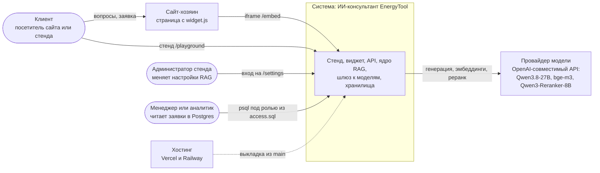
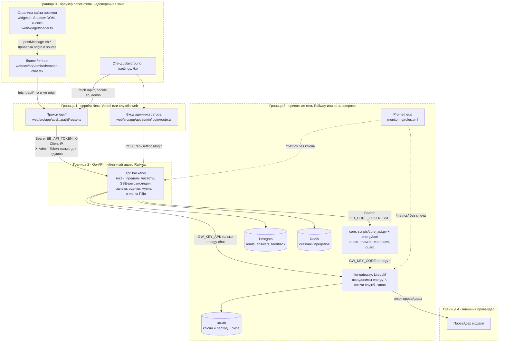

# Архитектура ИИ-консультанта МТС EnergyTool

Как устроен стенд, где проходят границы доверия, какие решения приняты и почему, от чего защищаемся и что
делать при сбоях. Документы описывают код ветки, в которой лежат. Чего в коде нет, так и помечено.

| Документ | О чём |
|---|---|
| этот файл | C4: контекст и контейнеры, границы доверия, секреты на каждой границе |
| [`adr/`](adr/) | шесть архитектурных решений в формате MADR |
| [`threat-model.md`](threat-model.md) | STRIDE по компонентам и потокам, соответствие OWASP Top 10 for LLM 2025 |
| [`runbook.md`](runbook.md) | что делать: модель недоступна, всплеск 429, переиндексация и откат, утечка ключа, удаление ПДн |

Решения (ADR):

| № | Решение | Статус |
|---|---|---|
| [0001](adr/0001-rag-instead-of-fine-tuning.md) | RAG по базе знаний вместо дообучения модели | принято, реализовано |
| [0002](adr/0002-hybrid-search-and-reranker.md) | гибридный поиск BM25 + bge-m3 через RRF, затем реранкер | принято, реализовано |
| [0003](adr/0003-sse-for-answer-stream.md) | SSE для потока ответа | принято, реализовано частично: этапы есть, токенов нет (T13) |
| [0004](adr/0004-go-api-and-python-core.md) | Go-API отдельно от Python-ядра | принято, реализовано |
| [0005](adr/0005-deterministic-lead-scoring.md) | детерминированный скоринг заявки | принято, реализовано (T3) |
| [0006](adr/0006-vision-only-as-ocr.md) | vision-модель только как OCR перед Qwen | принято, не реализовано (T9) |

Связанные документы: [`docs/deploy.md`](../deploy.md) (службы на Vercel и Railway, переменные),
[`docs/privacy.md`](../privacy.md) (персональные данные), [`backend/README.md`](../../backend/README.md),
[`web/README.md`](../../web/README.md), [`llm-gateway/README.md`](../../llm-gateway/README.md),
[`compose.yaml`](../../compose.yaml).

## C4 · Уровень 1: контекст

Пояснения:

- Клиент попадает в систему двумя путями: виджет на чужом сайте (`web/widget/loader.ts` → iframe `/embed`) или
  стенд (`/playground`). Оба идут в один и тот же сервер Next.
- Экрана менеджера пока нет (T5): заявки читаются из Postgres, роли — `backend/scripts/sql/access.sql`.
- Провайдер модели — внешняя система. На платформе организаторов это их vLLM, на стенде — любой
  OpenAI-совместимый API (`docs/development.md`, раздел «Внешний API модели»). Сабмит для автопроверки (`solution.py`) ходит
  к модели напрямую, стенд — только через шлюз.

## C4 · Уровень 2: контейнеры и границы доверия

Пунктирные рамки — границы доверия. Всё, что приходит из рамки выше, проверяется заново.

Локально (`docker compose up --build`) те же контейнеры живут на одной машине: наружу публикуются только порты
на `127.0.0.1` (`compose.yaml`), а ядро, шлюз, Redis и `llm-db` видны только в сети compose. Таблица служб и
адресов на хостинге — [`docs/deploy.md`](../deploy.md).

### Что проверяется на каждой границе

| Граница | Кто входит | Проверка | Где в коде |
|---|---|---|---|
| 0 → 0: сайт-хозяин ↔ iframe | страница чужого сайта | `postMessage` с точным `targetOrigin`; получатель сверяет `event.origin` и `event.source` | `web/widget/loader.ts`, `web/src/app/embed/embed-chat.tsx` |
| 0 → 1: браузер → Next | любой посетитель | список разрешённых путей `ALLOWED`; глобальные настройки — только с cookie администратора | `web/src/app/api/[...path]/route.ts`, `web/src/lib/backend.ts` |
| 1 → 2: Next → Go-API | только сервер Next | `Authorization: Bearer EB_API_TOKEN` (сравнение за постоянное время); `X-Client-IP` принимается, только если токен задан; `X-Admin-Token` для `POST /api/settings*` | `backend/internal/transport/http/server.go` (`requireToken`, `requireAdmin`, `clientIP`) |
| 2 → 3: Go-API → ядро | только Go-API | `Authorization: Bearer EB_CORE_TOKEN` (`hmac.compare_digest`); те же пределы диалога, что в Go | `scripts/core_api.py` (`authorized`, `clean_turns`, `Settings.validate`) |
| 3 → 3: ядро, api → шлюз | службы стенда | у каждой службы свой ключ, список моделей и пределы | `llm-gateway/keys.py`, `llm-gateway/config.yaml` |
| 3 → 4: шлюз → провайдер | только шлюз | ключ провайдера есть только у шлюза | `compose.yaml` (служба `llm-gateway`), `docs/deploy.md` раздел 1a |

### Какой секрет на какой границе

| Секрет | Кто знает | Что защищает | Что, если не задан |
|---|---|---|---|
| `EB_API_TOKEN` | сервер Next (`web`), Go-API | Go-API от прямых запросов в обход прокси; право верить `X-Client-IP` | в разработке проверка выключена; в бою API не стартует (`config.Verify`) |
| `EB_ADMIN_TOKEN` | сервер Next, Go-API | глобальные настройки RAG (`POST /api/settings`, `/settings/reset`) | глобальные настройки закрыты для всех, работает только песочница |
| `EB_CORE_TOKEN` | Go-API, ядро | ядро от остальных служб приватной сети | в бою API не стартует; ядро без токена открыто всем в сети |
| `GW_KEY_API` | Go-API, шлюз | доступ api к модели: только `energy-chat` и `energy-chat-fallback` | api ходит с мастер-ключом шлюза |
| `GW_KEY_CORE` | ядро, шлюз | доступ ядра к модели: все `energy-*` | ядро ходит с мастер-ключом шлюза |
| `LITELLM_MASTER_KEY` | только шлюз | администрирование шлюза и ключей служб | шлюз не стартует |
| ключ провайдера (`LLM_API_KEY` в `.env` → `GW_API_KEY` у шлюза) | только шлюз | расход у провайдера | стенд поднимается и отвечает заглушкой |
| `GW_FALLBACK_API_KEY` | только шлюз | запасной провайдер | запаса нет |
| пароли Postgres, `llm-db` | api, шлюз | данные заявок, ключи шлюза | — |

В браузер не попадает ни один из этих секретов: адрес и токен API знает только сервер Next
(`web/src/lib/backend.ts`), cookie администратора содержит не токен, а его HMAC. Значения в `compose.yaml` —
для разработки; на хостинге задаются свои (`docs/deploy.md`). Как менять секрет при утечке — [`runbook.md`](runbook.md#утечка-ключа).

## Путь одного вопроса

1. Браузер шлёт `POST /api/chat` `{messages, mode, overrides}` на свой origin.
2. Прокси Next проверяет путь по списку, добавляет `EB_API_TOKEN` и адрес посетителя, отдаёт поток без
   буферизации (`X-Accel-Buffering: no`, `maxDuration = 300`).
3. Go-API проверяет токен и предел частоты по адресу, чистит реплики (`backend/internal/dialog/dialog.go`),
   открывает поток к ядру и пересылает события как есть: `stage` → `stage` → `answer` → `done`. Пока ядро думает,
   раз в `EB_SSE_HEARTBEAT` (15 с) уходит комментарий `: ping`. Ответ ложится в `answers` с `request_id`.
4. Ядро проверяет токен, ещё раз чистит реплики и переопределения песочницы, ищет (BM25 + bge-m3 → RRF →
   реранкер), собирает контекст, зовёт модель через шлюз, проверяет числа ответа (`energybot/guard.py`).
5. Шлюз выбирает провайдера по псевдониму `energy-chat`; при 429/5xx/тайм-ауте уходит в запасной, если он задан.

Каждая ступень может отказать, не уронив ответ: без эмбеддингов — BM25, без реранкера — RRF, без модели — заглушка
с отказом (`energybot/pipeline.py`, `FALLBACK`), без модели у api — заявка с резюме-списком вопросов.
